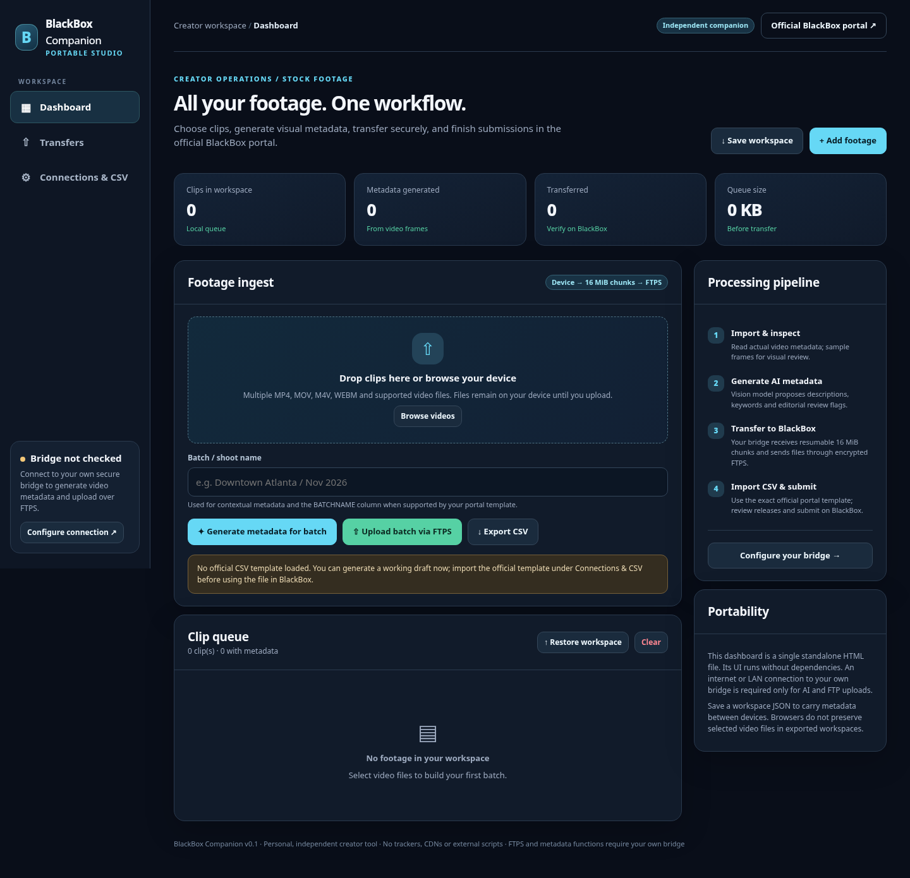
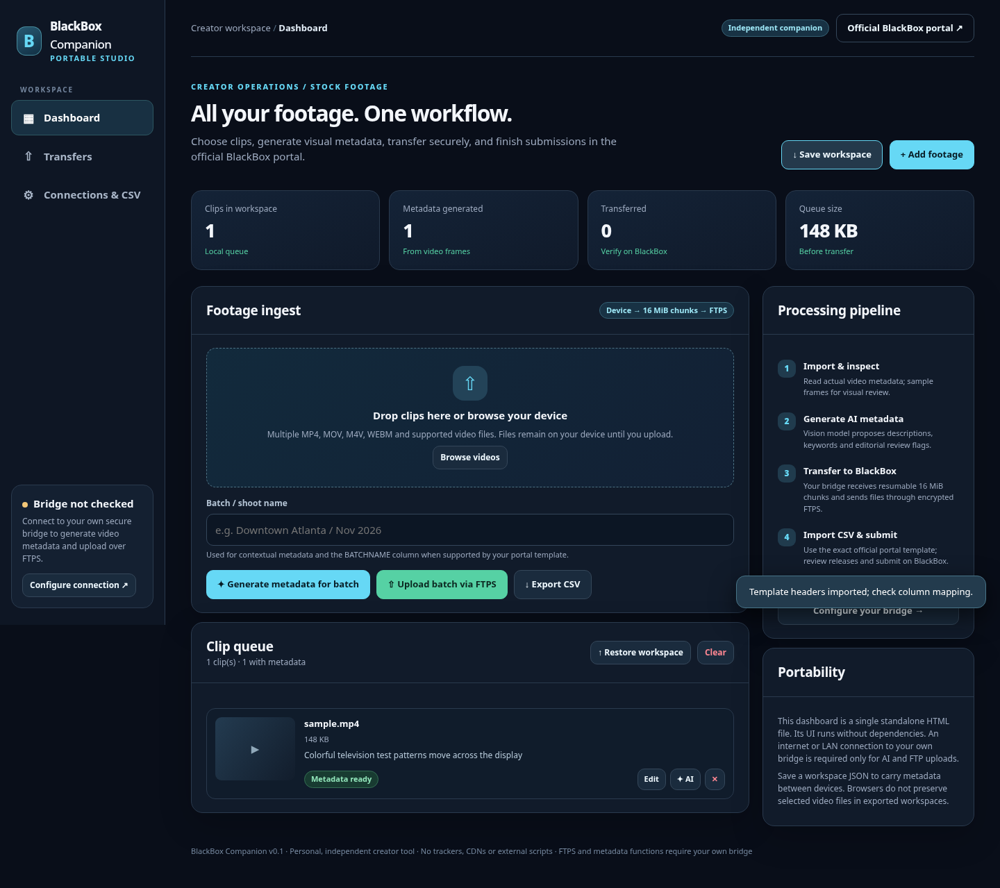
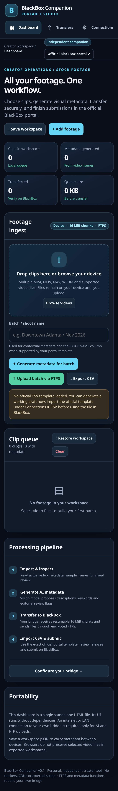

# BlackBox Companion — Portable Creator Dashboard







**Version:** 0.1.0 (2026-11-16)  
**Purpose:** One offline-capable HTML dashboard to carry between devices; optional self-hosted secure HTTP-to-FTPS and video-vision AI bridge.  
**Status:** Functional independent prototype with automated tests. **Not** connected to or endorsed by BlackBox Global.

## Deliverable inventory

| File | Purpose |
| --- | --- |
| `blackbox-portable-dashboard.html` | **The portable, dependency-free application**. It can open as an HTML file in many desktop browsers or be hosted as a static file for phones. |
| `bridge/server.py` | Authenticated FastAPI bridge: chunked browser transfers, explicit encrypted FTPS to BlackBox, visual AI metadata. |
| `bridge/compose.yaml` + `bridge/Dockerfile` | Docker deployment on a Mac, x86 server, or Raspberry Pi 5. |
| `bridge/.env.example` | Environment configuration; does **not** contain real credentials. |
| `tests/*` | Mock FTPS, metadata, CSV, browser interaction tests. |
| `dashboard-preview-*.png` | Real screenshots of the rendered browser dashboard. |

## What works immediately without a server

Open `blackbox-portable-dashboard.html` in a browser. Select multiple videos; enter a batch name; inspect the queue; edit each clip's metadata; import the **current, official** BlackBox CSV template; export a metadata CSV and save/restore JSON workspace snapshots. The HTML has no remote scripts, external fonts, trackers, or build tool dependencies.

**Important:** The HTML carries the *app*, not arbitrary original video files or signed-in BlackBox sessions. Export a `blackbox-workspace.json` for cross-device metadata and re-select the videos if reopening on a different device. Browser local storage, if available, holds an auto-saved snapshot on the same browser profile, but cannot transfer videos between devices. Video preview/AI frame extraction needs a codec the active browser can decode. Unsupported .MOV/.MXF encodings need a compatible proxy or prior conversion.

On iPhone/iPad, opening local HTML from the Files app can be restricted by the Files previewer or WebKit. For reliable cross-phone access, host this *unchanged single HTML file* at a personal HTTPS URL and bookmark it. It remains independently portable; hosting is a convenience, not a frontend build requirement.

## What needs the bridge

Browsers cannot directly create arbitrary FTP/FTPS TCP connections. To get FTP upload and AI metadata without installing clients on every device, host `bridge/server.py` once on your own computer/server and access it over HTTPS from the HTML.

- `Generate metadata`: browser samples **three real frames** (14%, 50%, 84%) and sends low-resolution JPEGs (not the entire original video) to your vision endpoint through the bridge. It returns an English title, concise description, up to 49 keywords, suggested category, and a rights/editorial review flag. Output is a **draft**. Verify accuracy and actual releases before submitting.
- `Upload batch`: browser uploads original footage in sequential **16 MiB** HTTP chunks. The bridge spools one clip on local disk, then independently transfers it using explicit FTPS with encrypted data channel. The browser polls transfer progress. Interrupted browser-to-bridge uploads can resume using the same session identifier if kept in the browser workspace. A completed HTTP intake runs its FTPS transfer on the bridge even if the browser tab closes.
- `Export CSV`: generated metadata is mapped into the **exact header names/order** from your actual imported BlackBox template. Where BlackBox changes its CSV schema, re-import its template and remap columns. No portal-side field values are invented, and unused columns remain blank.

**Current integration boundary:** FTP uploads are genuine when the bridge is configured; they have **not** been tested against a live BlackBox account here. CSV application and final clip submission **still occur in BlackBox's official authenticated portal** because this build has no verified public metadata-submission API. It will not scrape private site cookies or fake a logged-in session. FTP completion does not guarantee BlackBox ingested or accepted the clip.

## Setup once: containerized bridge

1. Copy the `bridge/` folder to a machine with a reachable HTTPS endpoint and adequate staging disk space (your Raspberry Pi 5 with NVMe or an x86 host is suitable).
2. From `bridge/` run `cp .env.example .env`.
3. Generate a long bridge token: `python3 -c 'import secrets; print(secrets.token_urlsafe(32))'`. Put the token in `.env`, along with your **real** BlackBox FTP username/password and configured FTPS directory from your portal instructions. Avoid committing `.env`. Use `chmod 600 .env`.
4. To use an OpenAI-compatible vision service, set `AI_CHAT_COMPLETIONS_URL`, `AI_MODEL`, and `AI_API_KEY` on the **bridge**, not in the HTML. The defaults target an OpenAI vision model; model/API usage may incur charges. A compatible local vision server can be substituted if its API supports image messages and JSON responses.
5. Run `docker compose up -d --build` from `bridge/`.
6. Publish **HTTPS** using your own Caddy reverse proxy, Tailscale, or trusted ingress. Bind the bridge container to localhost as configured; do not publicly expose its raw port without TLS. Configure `CORS_ORIGINS` for the hosted dashboard origin or `null` for a local `file://` HTML file.
7. In the HTML, visit **Connections & CSV**, enter the bridge HTTPS URL and access token, then select **Test connection**. Tokens are never serialized into the HTML or workspace export.

The bridge is bound to **127.0.0.1:8795** in Compose. Example Caddy configuration, replacing the domain and static root:

```caddyfile
blackbox.example.com {
    encode zstd gzip
    handle /api/* {
        reverse_proxy 127.0.0.1:8795
    }
    handle {
        root * /srv/blackbox-dashboard
        file_server
    }
}
```

Place `blackbox-portable-dashboard.html` in `/srv/blackbox-dashboard/` and open `https://blackbox.example.com/blackbox-portable-dashboard.html`. Set the dashboard's endpoint to `https://blackbox.example.com`. This keeps FTP credentials on the bridge, not in the browser.

### Cloudflare upload limits

Cloudflare proxied requests have an upload-body limit of **100 MB on Free/Pro plans** as of November 2026 (see [Cloudflare 413 documentation](https://developers.cloudflare.com/support/troubleshooting/http-status-codes/4xx-client-error/error-413/)). This implementation uses **16 MiB chunks**, so large videos can pass through such a proxy without a single oversize HTTP request. You still need adequate server storage and appropriate ingress timeouts. FTPS is established *outbound by your bridge*, not through the Cloudflare HTTP proxy.

### BlackBox FTP directory

Legacy BlackBox documentation distinguishes standard footage at `stock_footage` from separate collaborative project destinations. This package defaults to `stock_footage` in `.env` **but does not confirm your account's folder structure**. Verify in your BlackBox portal before real uploads; do not create or guess remote folders.

### Compatibility and accuracy limits

- Browser app requires modern HTML5 and JavaScript. The local HTML may be constrained by mobile file viewers and browser security policies.
- For accurate AI metadata, the active browser must be able to decode sample frames. The bridge **does not re-encode**, remove audio, or guarantee BlackBox's accepted frame rates, aspect ratios or release requirements.
- The template is a user-supplied file; validate all mappings. The generated metadata is a draft until accepted by BlackBox.
- A restarted bridge loses in-memory **FTPS job statuses**. Partially sent *HTTP chunks* can be recovered by their server-side session ID if the client preserved it. Finished job status isn't permanently archived.
- Stale incomplete uploads occupy local spool storage until manually cleaned; provision sufficient space and periodically inspect its spool volume.
- Browser tokens live only in sessionStorage when the browser supports it; use a secret manager/OS password manager for durable storage. Do not distribute a file with tokens added by hand.
- This prototype does not automatically create collaborative BlackBox projects, attach release documents, retrieve sales/account data, or programmatically import the metadata CSV into BlackBox.

## Tests

```bash
pip install -r bridge/requirements.txt pytest httpx playwright
python -m pytest -q tests/test_bridge.py
# Browser test needs Playwright + a locally installed Chromium and ffmpeg:
python -m pytest -q tests/test_frontend.py
```

The automated tests mock BlackBox FTPS and the vision provider. **No real uploads or external provider requests were executed.**

## Design priorities for later revisions

Keep the core HTML independently portable and BlackBox-neutral. Evolve the bridge via versioned APIs rather than hard-coding BlackBox UI HTML. Use connector adapters for official partner APIs if BlackBox eventually documents one. Consider background transfers to remove iOS tab-lifecycle limitations and local video preflight transcoding (FFmpeg) as separate bridge features rather than browser-heavy dependencies.
